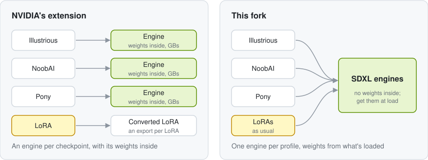

# TensorRT for reForge

A fork of [NVIDIA's TensorRT extension](https://github.com/NVIDIA/Stable-Diffusion-WebUI-TensorRT), rewritten for
[reForge](https://github.com/Panchovix/stable-diffusion-webui-reForge). It runs SD 1.x, SD 2.x and SDXL models on
TensorRT, fine-tunes like Pony, Illustrious and NoobAI included, on an RTX 2080 Ti or newer.

  <picture>
    <source media="(prefers-color-scheme: dark)" srcset="docs/engines-dark.svg">
    
  </picture>

## How it differs

|                | NVIDIA's extension                     | This fork                                             |
| -------------- | -------------------------------------- | ----------------------------------------------------- |
| WebUI          | Automatic1111                          | reForge                                               |
| Engines        | One per checkpoint, GBs each           | One per profile of an architecture (or one for all of them), no weights inside |
| New checkpoint | Build a new engine                     | Nothing to do                                         |
| LoRAs          | Convert each one first                 | Work as usual                                         |
| Hires. fix     | Build an engine that covers both sizes | Covered by the default profiles                       |

Anything the engines can't run, like ControlNet, UNet patches such as FreeU, or a size no profile covers, runs on
PyTorch instead, with a notice.

## Use

1. Install from **Extensions → Install from URL** with this repo's URL. TensorRT 11 or later is installed on the
   next launch (set `TRT_EXTENSION_SKIP_INSTALL=1` to skip that).
2. Load a checkpoint and open the **TensorRT** tab. The first time, it asks for the engine mode (below). Click
   **Build engines**; the first build takes a few minutes.
3. Generate. Every checkpoint with the same architecture now uses the engines. One is loaded at a time: each
   batch runs on the one that fits it best, and its Hires. fix stays on it if it covers the larger size.

**Engine modes.** *Per-profile engines*, the default, are an engine per profile, built one at a time; only the one
a generation's sizes need is loaded. A *merged engine* holds every profile of an architecture, so no pass ever
loads another engine, but it takes every profile's share of TensorRT's memory at once, and its build takes them all
at once: it needs at least 24 GB of VRAM and 64 GB of RAM. The mode can only change while there are no engines.

**SD Unet** (in Settings → Stable Diffusion) decides how generations run: `Automatic`, the default, uses the
engines; `Speed Hacks` uses them with Speed Hacks; `None` uses PyTorch.

**Speed Hacks.** Every engine comes with a small engine of just the UNet's outermost blocks. With Speed Hacks, about
half of the denoising steps run on it, reusing the deep features the full UNet computed a step or two before
([DeepCache](https://github.com/horseee/DeepCache)), and late in a pass, full steps wait longer while the image changes
smoothly ([AdaptiveDiffusion](https://jiakangyuan.github.io/AdaptiveDiffusion-project-page)). The first 30% and last 5%
of steps run in full, where composition and fine detail settle; both shares are in Settings → Stable Diffusion →
TensorRT. Passes of 12 steps or more should run roughly 1.6x as fast as on the engines alone (estimated); images are a
little less precise, so a seed gives a somewhat different image than without them. Fewer steps (e.g. with few-step
LoRAs) run as usual.

**VAE decoding.** The VAE's decoder gets engines too, built along with the UNet's for the same sizes. They run in the
precision reForge picks for the VAE (BF16 on RTX 30 series and newer, FP32 before; a `--vae-in-*` flag at build time
overrides it), so any VAE of the architecture decodes on them. A decode runs on them whenever they fit in the VRAM
that's free, and on PyTorch otherwise.

> [!NOTE]
> An engine only loads on the GPU and TensorRT version it was built with. After updating TensorRT, build again;
> the tab keeps the profiles.

 

  
   
  vibecoded with love by Claude

